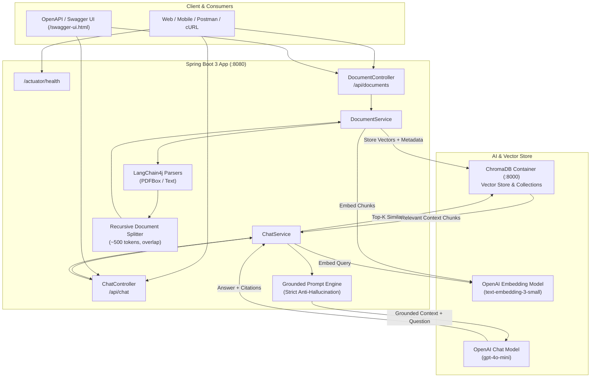

# DocChat API — RAG Document Q&A Service

[](https://adoptium.net)
[](https://spring.io/projects/spring-boot)
[](https://github.com/langchain4j/langchain4j)
[](https://www.trychroma.com)
[](LICENSE)

A production-style **Retrieval-Augmented Generation (RAG)** document question-answering REST API built with **Java 17**, **Spring Boot 3**, **LangChain4j**, **OpenAI**, and **ChromaDB**.

Users can upload documents (`PDF`, `TXT`, `MD`). The service automatically parses, token-splits, generates OpenAI dense embeddings (`text-embedding-3-small`), and indexes them into ChromaDB. When queried, it retrieves the most relevant semantic chunks and prompts the chat model (`gpt-4o-mini`) with strict grounding rules to produce precise answers accompanied by verifiable source citations. If the document does not contain the answer, the service answers honestly rather than hallucinating.

---

## Architecture Overview



---

## Tech Stack

| Component | Technology | Purpose |
| :--- | :--- | :--- |
| **Language & Framework** | Java 17, Spring Boot 3.3.4 | Core enterprise runtime and REST API |
| **LLM & Embeddings** | LangChain4j 0.35.0, OpenAI API | Orchestration, `gpt-4o-mini`, `text-embedding-3-small` |
| **Vector Store** | ChromaDB (Docker) | Dense vector storage, cosine similarity indexing |
| **Document Parsers** | Apache PDFBox, LangChain4j Text Parser | Native PDF, TXT, and Markdown parsing |
| **API Documentation** | springdoc-openapi 2.6.0 | Interactive OpenAPI 3 spec & Swagger UI |
| **Observability** | Spring Boot Actuator | `/actuator/health`, metrics, and liveness probes |
| **Containerization** | Docker, Docker Compose | Single-command multi-container deployment |
| **Testing** | JUnit 5, AssertJ, Mockito, MockMvc | Unit and integration test coverage |

---

## Endpoints

| Method | Path | Description |
| :--- | :--- | :--- |
| `POST` | `/api/documents` | Upload PDF/text &rarr; parse, chunk (~500 tokens), embed, and store in ChromaDB |
| `GET` | `/api/documents` | List all ingested documents and chunk metadata |
| `GET` | `/api/documents/{id}` | Retrieve metadata for a specific document |
| `DELETE` | `/api/documents/{id}` | Delete a document and purge all its embeddings from ChromaDB |
| `POST` | `/api/chat` | Query documents: `{ "question": "..." }` &rarr; grounded answer + cited source chunks |
| `GET` | `/actuator/health` | Service health check |
| `GET` | `/swagger-ui.html` | Interactive Swagger UI API documentation |

---

## Quickstart (Single Command)

### 1. Prerequisites
- [Docker](https://www.docker.com/) and [Docker Compose](https://docs.docker.com/compose/)
- An [OpenAI API Key](https://platform.openai.com/api-keys)

### 2. Configure Environment
Copy the example environment file and set your OpenAI API key:

```bash
cp .env.example .env
```

Edit `.env`:
```env
OPENAI_API_KEY=sk-proj-your-actual-api-key-here
```

### 3. Spin Up Services
Run the entire stack with Docker Compose:

```bash
docker compose up --build -d
```

Check container status and logs:
```bash
docker compose ps
docker compose logs -f app
```

Once started:
- **Application API**: `http://localhost:8080`
- **Swagger UI**: `http://localhost:8080/swagger-ui.html`
- **ChromaDB**: `http://localhost:8000`
- **Health Check**: `http://localhost:8080/actuator/health`

To shut down:
```bash
docker compose down
```

---

## Running Locally Without Docker

If you have **Java 17+** and **Maven** installed locally:

1. Start ChromaDB in Docker:
   ```bash
   docker run -d --name chromadb -p 8000:8000 chromadb/chroma:0.5.5
   ```

2. Export your OpenAI key:
   ```bash
   export OPENAI_API_KEY="sk-proj-your-actual-api-key-here"
   ```

3. Run the Spring Boot application:
   ```bash
   mvn spring-boot:run
   ```

4. Run unit tests:
   ```bash
   mvn test
   ```

---

## Sample cURL Requests

### 1. Health Check
```bash
curl -X GET http://localhost:8080/actuator/health
```
**Response:**
```json
{
  "status": "UP"
}
```

---

### 2. Upload Document (PDF or Text)
Upload a document to parse, chunk into ~500 tokens, generate dense embeddings, and index into ChromaDB:

```bash
curl -X POST http://localhost:8080/api/documents \
  -F "file=@sample_policy.txt"
```
**Response (`201 Created`):**
```json
{
  "id": "doc_a1b2c3d4e5f6",
  "fileName": "sample_policy.txt",
  "contentType": "text/plain",
  "sizeBytes": 1420,
  "chunksCount": 2,
  "uploadedAt": "2026-10-11T21:30:00.000Z"
}
```

---

### 3. List Ingested Documents
```bash
curl -X GET http://localhost:8080/api/documents
```
**Response (`200 OK`):**
```json
[
  {
    "id": "doc_a1b2c3d4e5f6",
    "fileName": "sample_policy.txt",
    "contentType": "text/plain",
    "sizeBytes": 1420,
    "chunksCount": 2,
    "uploadedAt": "2026-10-11T21:30:00.000Z"
  }
]
```

---

### 4. Ask a Question (Grounded Q&A with Citations)
Query the knowledge base:

```bash
curl -X POST http://localhost:8080/api/chat \
  -H "Content-Type: application/json" \
  -d '{
    "question": "What is the annual paid time off policy?"
  }'
```
**Response (`200 OK`):**
```json
{
  "question": "What is the annual paid time off policy?",
  "answer": "According to sample_policy.txt, full-time employees are entitled to 20 days of paid time off per calendar year, accruing at 1.67 days per month.",
  "citations": [
    {
      "documentId": "doc_a1b2c3d4e5f6",
      "documentName": "sample_policy.txt",
      "chunkIndex": 0,
      "text": "Full-time employees are entitled to 20 days of paid time off per calendar year, accruing at 1.67 days per month...",
      "relevanceScore": 0.892
    }
  ]
}
```

---

### 5. Out-of-Domain Question (Anti-Hallucination Fallback)
When asked a question not covered in the uploaded documents, the model responds honestly rather than inventing facts:

```bash
curl -X POST http://localhost:8080/api/chat \
  -H "Content-Type: application/json" \
  -d '{
    "question": "What is the capital of Mars?"
  }'
```
**Response (`200 OK`):**
```json
{
  "question": "What is the capital of Mars?",
  "answer": "I could not find the answer in the provided documents.",
  "citations": []
}
```

---

### 6. Delete Document and Embeddings
Remove a document and purge all its vectors from ChromaDB:

```bash
curl -X DELETE http://localhost:8080/api/documents/doc_a1b2c3d4e5f6
```
**Response (`204 No Content`)**

---

## Postman Collection

A complete Postman collection is committed under [`postman/DocChat_API.postman_collection.json`](postman/DocChat_API.postman_collection.json).
- Import into Postman.
- Set `baseUrl` variable to `http://localhost:8080`.
- The upload request automatically saves the resulting `documentId` into collection variables for one-click testing of GET and DELETE operations.

---

## Showcase Copy (Upwork / Portfolio)

Ready-to-paste project descriptions and proposals for Upwork and client bids:

### Upwork Portfolio Title
```text
DocChat API — RAG Document Q&A Service (Spring Boot + LangChain4j)
```

### Upwork Portfolio Description
```text
Production-style retrieval-augmented generation service built with Java 17, Spring Boot 3, and LangChain4j. Upload PDF/text documents; the service chunks and embeds them into ChromaDB and answers questions with cited sources. Includes a REST API with OpenAPI docs, Docker Compose deployment, Postman collection, and unit tests. Demonstrates: LLM API integration, embeddings/vector search, prompt design with grounded answers, and clean enterprise Java delivery.
```

### Proposal Snippet (for AI-Integration Jobs)
```text
On the AI side, I built a RAG document-Q&A service with Spring Boot + LangChain4j and ChromaDB — ingestion, embeddings, retrieval, and cited answers — happy to share the repo: [GitHub link]. The engineering pattern (clean API layer, error handling, tests, Docker deployment) is the same one I'd bring to your project.
```

### Skill Tags
`LangChain4j` &bull; `Spring AI` &bull; `OpenAI API` &bull; `Vector Database` &bull; `Retrieval-Augmented Generation (RAG)` &bull; `Docker Compose` &bull; `Java 17` &bull; `Spring Boot 3`
